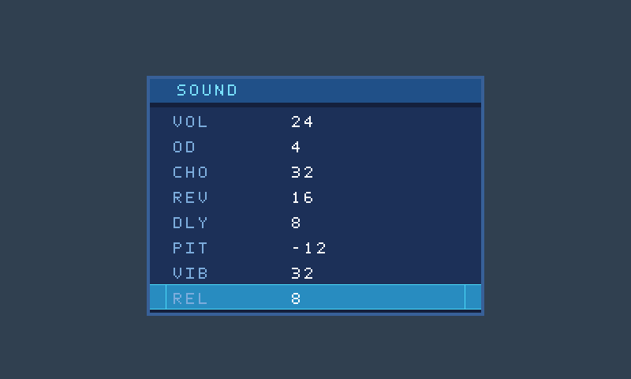
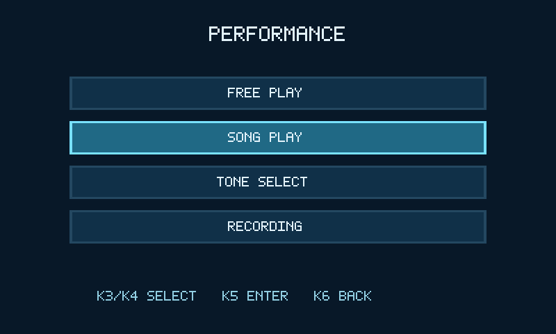

> 本文件为SRC-046历史说明。当前版本、构建入口及通过证据请先读[工程README](../README.md)与[验证摘要](验证摘要.md)。旧资源/时序数字不作为本版结论。

> 2026-11-02新增第四种马林巴，ID4，32声部实时周期波表；菜单和录音同步支持。原卡、App、ESP32及全部现有9_5功能保持，见[马林巴合并说明](MARIMBA_MERGE_20261102.md)。下方三音色说明保留原音源历史。
>
> 2026-10-23三音色实时合成修订：原电子琴更名电钢琴，移除原PCM电钢琴入口；吉他/萨克斯改为实时周期波表。原音源及F盘说明见[三音色修订说明](三音色实时合成修订说明.md)。

# competition_9_5 使用说明

2026-10-29的GUIDE为[黄灯渐灭与节奏评分](TIMED_GUIDE_20261029.md)：绝对时间推进，拍前500ms线性渐灭，到拍熄灭；只有命中才绿、错误键红，同键队列用真实剩余时间。下述接线、旋钮、AUTO、录制保持，计分与调试按专项说明。

打开competition_9_5.gprj；保留impl/competition_9_5_process_config.json及build.tcl；必要构建配置应随工程保留。主旋钮使用原138K Pro接线，第二旋钮不再需要；App和F:卡沿用。本次没有执行烧录。

新增灯链接线及实际复音边界见[专项说明](灯链与旋钮融合说明.md)。原矩阵L18/L17两条行线需断电拔下，L18改为灯链数据。

## 旋钮与浮窗

主旋钮按下按表循环选项，旋转调整。主旋钮操作唤出SOUND浮窗；停止约3秒后渐隐，约1.5秒消失。

| 顺序 | 显示 | 参数 | 范围/默认 |
| --- | --- | --- | --- |
| 1 | VOL | 音量 | 0～32，默认24；0同时静音效果尾音 |
| 2 | OD | 过载 | 0～4，默认0 |
| 3 | CHO | 合唱 | 0～32，默认0 |
| 4 | REV | 混响 | 0～32，默认0 |
| 5 | DLY | 回声 | 0～32，默认0，延迟约171ms |
| 6 | PIT | 移调 | −12～+12半音，默认0 |
| 7 | VIB | 颤音 | 0～32音分，每档4音分，默认0 |
| 8 | REL | 松键释放时间 | 0～8档，默认0；越大释放越长 |

从VOL开始按7次进入REL，旋转调整，再按1次回到VOL。切换选项保留已设数值；按住不会自动连跳。按下与旋转步进恰好同一周期时，优先切换选项，不修改上一项。

REL沿用9_2原映射，0档满幅释放约100ms；作用于当前电钢琴/吉他/萨克斯/马林巴共享32声部的释放控制，实际尾音也受当前包络幅度与音效影响。

只需一个带按压编码器：S1/S2/KEY继续连接FPGA A18/A17/A19；9_5这三项均为PULL_MODE=NONE（不启用内部上拉或下拉），电源和地沿用原正确接线。第二旋钮的B19/A20/B20顶层接口及约束已删除；不必移接其信号线，断电后可撤下第二旋钮。

相位滤波采用100微秒，按净位移累计完整四相转换产生一步；有效回弹反向抵消一步，避免清零导致丢步。按键继续5毫秒去抖。仿真覆盖新旧解码同波形对照、真实100MHz滤波、快速边沿、抖动、反转、非法跳变、八项整机控制及按住不重复；实际手感待上板。

## 菜单与按键

PERFORMANCE四入口：FREE PLAY、SONG PLAY、TONE SELECT、RECORDING。仅接前两行，K编号沿用原4×4扫描顺序，K1～K4第一行，K5/K6第二行前两颗，不一定等于键帽标字。

- 菜单：K3/K4移动，K5进入，K6返回。
- SONG PLAY：K1/K2选曲，K3/K4选GUIDE/AUTO，K5开始/停止/重播，K6取消返回。加载/播放锁选曲；取消后迟到完成不会开播。
- TONE SELECT：K3/K4预选，K5确认，K6取消。四种音色均可直接确认，不等待原PCM音库加载。马林巴为第四项，按住后会自然衰减。
- RECORDING：16槽、录制/回放/删除、覆盖确认和事务锁保持。回放自动使用录制音色，结束/停止后恢复手动音色。详见[录音与安全存储](录音与安全存储.md)。
- 板载S0移动三键音高组；S1/S2/S3按住发声、松开释放。接线和按键用途保持。

## 复音与兼容范围

| 模式 | 同时发声 |
| --- | --- |
| 电钢琴E-PIANO | 32个实时波表独立声部，MIDI通道1、音符36～84 |
| 吉他/萨克斯/马林巴 | 各32个实时波表独立声部，共用同一引擎，一次选择一种音色 |
| 自动曲谱 | 原4音和弦；所选音色其余可用槽可叠加实时MIDI |
| 录音 | 4音、最多2048事件、16槽；不记录效果/弯音轨迹 |

四音色32复音含踏板和释放尾音，第33音按轮转策略抢占；LCD保留32键快照。开始录音后新增分配限低4槽，之前高槽尾音自然释放。PT8211和App保持；旧录音音色1映射到新电钢琴0，吉他2/萨克斯3不改编号，新增马林巴为4。

## 原卡与手机

继续使用F:原卡，无须复制新音库、重建空槽或覆盖已有歌曲/录音。TONES49.BIN仍86704128字节；SONG/TAKE/SAVESLOT/REC保留。首次大音库装入仍需超过理论56秒；四种实时音色都可先弹；该镜像不参与音频输出，SD曲谱/录音服务继续等待原加载流程就绪。

App仍用VOL、SB/SD/SE、PA/PG/PS/SQ完成RAM上传与演奏；具名16曲库MB/MD/ME/MQ及当前SC/SCQ八参数读写保持。音效可由本地旋钮与参数版App控制，本次马林巴合并不修改App。

## 验证和上板

源码、仿真、实现与未测项分列于[验证摘要](验证摘要.md)。码流为impl/pnr/competition_9_5.fs。上板前核对当前工程、器件与接线。本轮未连接或配置板卡，真实音效试听、温升、总延迟和SD掉电仍待验收。

## RTL界面预览

以上为RTL输出像素，非实板照片。REL浮窗为本版独立渲染测试，显示值用于测试；上电默认REL仍为0。四项菜单沿用9_2，渲染器保持。
