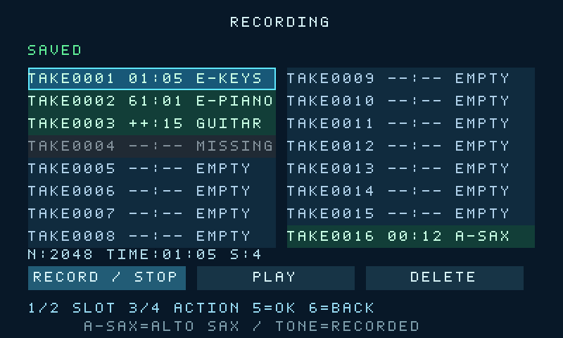

# 演奏录制、回放与安全存储

RECORDING是PERFORMANCE四个入口之一，复用K1～K6。屏幕两列各8槽，显示TAKE0001～TAKE0016、MM:SS时长及录制时的乐器音色。空槽为EMPTY，不可用槽为MISSING；目录检查期间为CHECK。超过99分钟显示++:SS；N是本次录音事件数，TIME是录制时长或停止后的总时长。

已保存音色标签：E-KEYS=电子琴，E-PIANO=电钢琴，GUITAR=原声吉他，A-SAX=中音萨克斯。标签来自录制开始时锁定并随录音保存的音色，切换当前演奏音色、覆盖其他槽或重新上电不会改变它；成功覆盖更新本槽标签，删除后变EMPTY。回放自动使用本次实际校验通过的录音提交副本音色；若校验回退旧副本，以旧副本的内容与音色为准，可能与先前扫描的目录标签不同。完整PNO载入通过、淡出/静音切换/淡入完成后开始发声。自然结束或停止后，按同样的平滑切换恢复回放前手动选择的音色。



## 操作

| 页面/状态 | 操作 |
| --- | --- |
| 录音主页 | K1/K2选择16个槽；K3/K4在RECORD / STOP、PLAY、DELETE三个动作中循环；K5执行；K6返回PERFORMANCE |
| RECORD / STOP | K5开始录制；若目标已有录音，先弹出覆盖确认，K5确认、K6取消 |
| 正在录制 | K5停止并保存；K6停止、保存成功后返回PERFORMANCE；不能换槽、切页或删除 |
| PLAY列表 | K1/K3上一条、K2/K4下一条有效录音；K5载入并切换到录制音色后自动回放；K6取消加载或停止回放、恢复原手动音色并返回主页 |
| DELETE列表 | 同上选择录音，K5打开确认；确认页K5删除、K6取消；K6在普通列表返回主页 |
| 封口/CRC/保存/载入 | 封口和保存需等待，保存完成并读回才显示SAVED；PLAY载入期间K6可取消，其余操作仍锁定到本次SD命令结束 |
| 保存失败 | 保留本次RAM快照与原目标槽；K5重试。K1～K4不会改目标；断电会丢失尚未保存的新快照 |
| CHECKING SLOTS | 等待SD音库和录音目录检查；K5暂不启动操作，K6仍可返回，不提前报MISSING/ERROR |
| NO SLOTS PREPARED | 目录检查已完成但无可用TAKE槽；按提示补齐文件并重新上电，不表示FPGA资源不足 |

覆盖/删除确认期间K1～K4无效，避免确认对象变化。录音完成后自动选择第一个已准备的空槽；全部占满时保留当前槽，下一次录制需确认覆盖。删除只清除指定槽的新有效记录，不修改目录、FAT或其他录音。

空录制没有音符时不写SD；原录音保持。达到2048事件或输入队列溢出时自动停止、封口并保存已接受事件。EVENT LIMIT表示录制已经结束，上限提示会保留；需等SAVING结束且底部S:4才代表保存完成，S:5表示失败。普通录制完成显示SAVED。保存失败时留在录音页供重试，即使最初按的是K6。收到手机上传或其RAM备份尚未完成时，等待BUSY结束后再开始新的录音动作；录音事务期间手机上传/播放请求会返回BUSY。

## 录制范围

遇到ERROR时优先处理错误，不能仅凭状态数字认为成功。S:5通常是读写/CRC或槽格式失败；未找到槽等错误可能显示S:1。确认文件已准备且卡连接正常后K5重试；不要用工厂空文件覆盖已有录音。

记录MIDI通道1（HDL channel=0）的C2～C6、音符36～84的起音、力度和时长；Note On力度0按松键处理。CC64延音踏板会延长对应音符，CC120/123封闭全部持音。停止时所有持音都会封口；同毫秒重复/第五音按最少1ms归一化，保证标准PNO1最多4个重叠发声音符。

录音只记录外接MIDI演奏，不录板载S1～S3、音频波形、手机自动伴奏或连续Pitch Bend/CC1/旋钮变化。回放使用该录音保存的音色，移调、音量、过载和Release等设置沿用当前值。自然结束、录音页K6（或GUIDE/AUTO页K6）及手机PS停止后恢复回放前手动音色；连续重播/换槽仍保留最初的手动选择。准备/恢复期间显示BUSY，K5暂不执行新动作；在录音页K6仍可取消待播/停止并返回，已经开始的音色恢复会继续完成；若录音所需PCM未就绪会等待，不能用其他音色代替。回放音色会话及恢复期间，TONE SELECT的K5暂不接受手动切音，以免覆盖自动音色。手机VIEW继续只切换显示页面，演奏可继续，回放仍保持AUTO及录制音色；其他显示页K6沿用该页的返回/取消含义，不是全局停止键。旧录音仍在回放时，重新进入录音主页不能直接开始新录制，先K6停止旧回放并等待恢复，再录制。各音符时长字段最大65535ms，超长持音截到该字段上限。最长计时65535秒；先达到事件/计时/队列上限则自动停止。四种音色仍按原菜单手动切换。

## SD文件

保留原TONES49.BIN、SONGS.CAT、SONGxxx.PNO和SAVESLOT.BIN。新增TAKE0001.BIN～TAKE0016.BIN共1MiB，每个64KiB，工厂空文件不是普通PNO曲谱。硬件只对名字精确匹配、长度正确、标记CRC正确且FAT映射无循环的文件写入；支持1/8/64/128等每簇扇区数与碎片链。板上不会创建文件或分配簇。

在工程目录执行`python tools/create_record_slots.py F:/`只补缺失槽；已有文件始终保留。若显示MISSING，检查根目录是否有对应文件，或用`python tools/check_sd_card.py F:/ --hash`只读检查。工具会报告文件长度、标记或已提交负载的格式错误；标记正常但两个提交副本均无效时，会按无有效录音的空槽报告，不能据此判断文件从未使用或没有损坏。已有文件无论检查结果如何都保留，先在电脑备份后由用户决定如何处置，不要直接复制工厂空槽覆盖。

2026-10-18本次F:修复：已补齐16个TAKE空槽；按用户明确指示删除两条旧录音REC001.PNO/REC002.PNO，没有导入。其余24个原文件SHA保持。卡不需格式化；在Windows安全弹出后插回板卡并重新上电，等待CHECKING SLOTS结束。已补齐的空槽应显示EMPTY，录制并保存成功后显示时长与原录制音色。

双副本布局：扇区0为不可变C7SLOT01标记，提交头在1/65，负载在2～34/66～98。头包含generation、负载长度/计数/CRC、时长/音色、头CRC及generation反码。先使非活动头失效，再写完整负载，最后提交头；读回头与负载CRC后宣布成功。上电按有效代际选最新副本，写失败或中途断电可保留上一个成功副本。删除提交8字节的标准空PNO1，所以下次开机不会从更旧副本复活已删录音。这是逻辑保护，SD卡自身掉电缓存行为仍须实卡测试。

## 旧录音导入与导出

原REC001.PNO～REC016.PNO不会被自动覆盖，也不会自动当作新槽。需要时先在电脑备份，再将合法旧录音转换到一个尚不存在的新文件：

```powershell
python tools/convert_recording.py import-legacy 原卡备份/REC001.PNO 临时目录/TAKE0001.BIN --tone 0
python tools/convert_recording.py export 原卡备份/TAKE0001.BIN 临时目录/录音.PNO
```

tone的0/1/2/3是电子琴/电钢琴/吉他/萨克斯。输出已存在时拒绝覆盖。导入只读取旧文件count声明的有效事件，识别旧保留字段中的时长、固定缓冲区的未定义尾部；输出改为保留位0的严格PNO1。旧包产生的零持续、重复同音起点或超过4音重叠会被明确拒绝，不静默截断或损坏原件。导出的标准PNO可用作本地SONG曲谱，配套更新目录；手机App自身的格式/容量限制保持。
